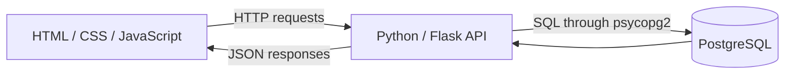
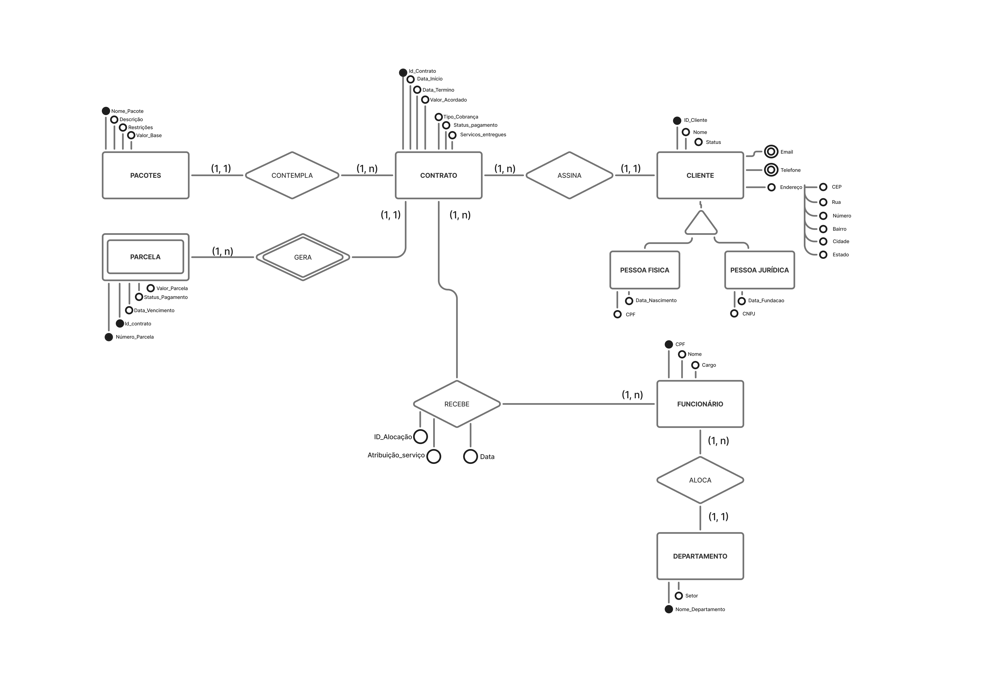

# Marketing Agency Database

An academic relational database project developed for the Database I course in the Systems and Digital Media undergraduate program at the Federal University of Ceará (UFC).

The project models a digital services agency and connects a **PostgreSQL database** to a **Python/Flask API** and a browser interface.

## Overview

The agency sells service packages to individual and corporate clients, manages contracts and payment installments, and assigns employees from different departments to contracts.

The implementation demonstrates:

- Relational modeling with primary, foreign, and composite keys.
- SQL queries using joins, subqueries, aggregation, and existence checks.
- Referential integrity and selective cascading deletes.
- Database integration through a Flask API.
- Client registration and deletion through a web interface.

## Architecture



## Technology Stack

| Component | Technologies |
|---|---|
| Database | PostgreSQL |
| Backend | Python, Flask, psycopg2 |
| Frontend | HTML, CSS, JavaScript |
| Configuration | python-dotenv |
| Local cross-origin requests | Flask-CORS |

## Data Model

The database contains 11 tables:

| Table | Purpose |
|---|---|
| `Cliente` | Client details and primary contact information |
| `Cliente_Email` | Additional client email addresses |
| `Cliente_Telefone` | Additional client phone numbers |
| `Pessoa_Fisica` | Individual client details |
| `Pessoa_Juridica` | Corporate client details |
| `Departamento` | Employee departments |
| `Funcionario` | Employees and department assignments |
| `Pacotes` | Service packages |
| `Contrato` | Client contracts |
| `Parcela` | Contract payment installments |
| `Recebe` | Employee assignments to contracts |

### Modeling Decisions

- **Client specialization:** Individual and corporate client details are stored in separate tables referencing `Cliente`.
- **Additional contacts:** Email addresses and phone numbers can be stored in dedicated tables alongside the primary contact fields.
- **Dependent installments:** Each installment is identified by the composite key `(Id_Contrato, Numero_Parcela)`.
- **Many-to-many assignments:** `Recebe` connects employees to contracts using `(Id_Contrato, CPF_Funcionario)` as its primary key.
- **Selective cascading deletes:** Deleting a client also removes dependent contact and specialization records. Clients referenced by contracts cannot be deleted.
- **Monetary values:** Contract and installment amounts use PostgreSQL `NUMERIC` columns.

The schema does not enforce that every client belongs to exactly one specialization.

### Entity–Relationship Diagram



## SQL Queries

| Endpoint | Business question | SQL concepts |
|---|---|---|
| `GET /consulta1` | Which clients have at least one contract worth 3,000 or more? | `IN` subquery |
| `GET /consulta2` | Which states have an average contract value above 1,000? | `INNER JOIN`, `AVG`, `GROUP BY`, `HAVING` |
| `GET /consulta3` | Which departments do employees belong to? | `INNER JOIN` |
| `GET /consulta4` | Which clients have contracts, including those without one? | `LEFT JOIN` |
| `GET /consulta5` | Which contracts have an employee assigned? | Correlated `EXISTS` subquery |

Clients without contracts are included in `/consulta4`; clients with multiple contracts may appear in multiple rows.

## Client Operations

### Create a client

```http
POST /clientes
Content-Type: application/json
```

Example request:

```json
{
  "nome": "Demo Client",
  "status": "Ativo",
  "cidade": "Fortaleza",
  "estado": "CE"
}
```

The API requires a nonempty name. When provided, the state field must contain two characters.

Successful requests return `201` and the new client ID.

### Delete a client

```http
DELETE /clientes/<id_cliente>
```

Responses:

- `200`: Client deleted.
- `404`: Client not found.
- `409`: Deletion blocked because the client has contracts.

Client creation and deletion use parameterized SQL statements.

## Repository Structure

```text
bd-agenciaMarketing/
├── backend/
│   ├── app.py
│   └── requirements.txt
├── db/
│   ├── schema.sql
│   └── seed.sql
├── docs/
│   └── DER.png
├── frontend/
│   ├── index.html
│   ├── script.js
│   └── style.css
├── .gitignore
└── README.md
```

## Run Locally

### Prerequisites

- PostgreSQL running locally.
- The `psql` command available in your terminal.
- Python and pip.
- A web browser.

### 1. Clone the repository

```bash
git clone https://github.com/ArtemisMenezes/bd-agenciaMarketing.git
cd bd-agenciaMarketing
```

### 2. Create and populate the database

Run from the repository root against a new database.

On Windows PowerShell, set the client encoding first:

```powershell
$env:PGCLIENTENCODING = "UTF8"
```

Create the database:

```bash
psql -U postgres -c "CREATE DATABASE bd1 ENCODING 'UTF8' TEMPLATE template0;"
```

Create the tables:

```bash
psql -U postgres -d bd1 -v ON_ERROR_STOP=1 -f db/schema.sql
```

Load the sample records:

```bash
psql -U postgres -d bd1 -v ON_ERROR_STOP=1 -f db/seed.sql
```

If PostgreSQL uses a different port, add `-p YOUR_PORT` to each command.

The scripts are intended for an initial setup. Running them again against populated tables can cause duplicate table or key errors.

### 3. Configure the backend

Create a file named `.env` inside `backend/`:

```dotenv
DB_HOST=localhost
DB_NAME=bd1
DB_USER=postgres
DB_PASSWORD=your_local_database_password
DB_PORT=5432
```

Replace the placeholder with your local password. The repository does not include an `.env.example` file.

Never commit your `.env` file.

### 4. Install dependencies and start the API

**Windows — PowerShell:**

```powershell
cd backend
python -m venv .venv
.\.venv\Scripts\python.exe -m pip install -r requirements.txt
.\.venv\Scripts\python.exe app.py
```

**macOS / Linux:**

```bash
cd backend
python3 -m venv .venv
.venv/bin/python -m pip install -r requirements.txt
.venv/bin/python app.py
```

The API connects to PostgreSQL during startup. Start the database and configure the connection before running the application.

Visit:

```text
http://127.0.0.1:5000/
```

The expected response is:

```text
Servidor Flask + PostgreSQL funcionando!
```

### 5. Open the frontend

Open `frontend/index.html` in your browser.

Keep the backend running. The frontend is configured to send requests to `http://127.0.0.1:5000`.

The interface is in Brazilian Portuguese.

## Manual Verification

After setup:

1. Run each of the five queries from the interface.
2. Confirm that results appear in a table.
3. Create a demonstration client and note the returned ID.
4. Delete that client using its ID.
5. Attempt to delete a client referenced by a contract; the API should return `409`.

These are suggested manual checks, not an automated test suite.

## Results and Scope

The repository includes a relational schema with 11 tables, sample data, five SQL query endpoints, and client creation and deletion.

This documentation was checked against the source files. Database setup and application execution were not performed during the documentation review. No performance benchmarks are reported.

## Limitations

- The interface provides client creation and deletion, but no update operation.
- Contracts, packages, employees, and installments do not have management endpoints.
- The backend uses a single shared database connection without connection pooling.
- Monetary values are converted from `Decimal` to floating-point numbers for JSON responses.
- Authentication and authorization are not implemented.
- The Flask server uses debug mode, and CORS is broadly enabled for local development.
- Dependencies are listed without pinned versions.
- Automated tests, migrations, and deployment configuration are not included.
- The sample data supports query demonstrations; the application does not enforce a complete billing workflow.

## Author

[Ártemis Menezes Castelo](https://github.com/ArtemisMenezes)
